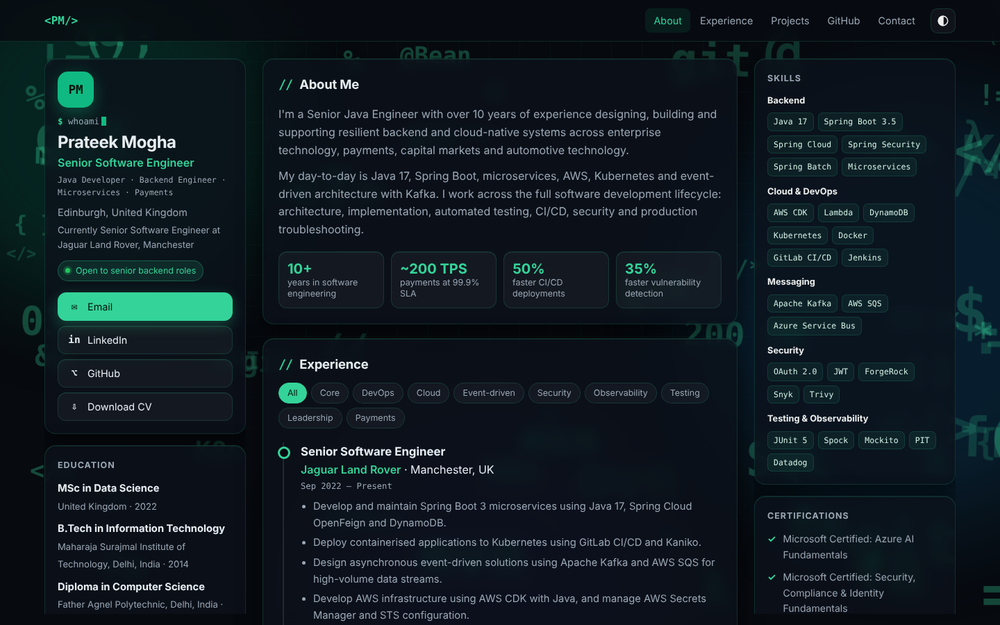

# Prateek Mogha – Portfolio

Personal portfolio site of **Prateek Mogha**, Senior Java Engineer based in Edinburgh, UK.
Java 17, Spring Boot, microservices, AWS, Kubernetes and Kafka, with experience across payments, capital markets and automotive technology.

**Live site:** https://moghaprateek.github.io
**LinkedIn:** https://www.linkedin.com/in/moghaprateek/



## What it is

A single-page portfolio built with plain HTML, CSS and JavaScript. There is no framework and no build step, so it publishes straight from GitHub Pages.

- Dark developer theme: near-black background, emerald accents, a faint grid and floating code symbols (`</>`, `{ }`, `git`, `@Bean` and more). Light mode is available from the toggle.
- Three-column dashboard layout: profile and education (left), content (middle), skills and certifications (right). The side panels stay in place while the middle scrolls.
- Frosted-glass cards with low blur, so the text stays easy to read.
- Experience timeline with filter buttons by theme (Cloud, Security, Payments and so on).
- Projects and GitHub projects shown as minimal lists, plus contact links and a CV download button.
- Dark by default for new visitors; the choice is remembered per visitor.
- Responsive: side panels stack above the content on tablets, and everything becomes a single column on phones.
- Search and sharing support: page title and description, structured data, a social preview image, `robots.txt` and `sitemap.xml`.

## Files

| File | Purpose |
|---|---|
| `config.js` | **All your content.** This is the file you edit for normal updates. |
| `index.html` | Page structure, styles, rendering code and search/sharing tags. |
| `Prateek_Mogha_CV.pdf` | The CV behind the "Download CV" buttons. |
| `og-image.png` | Preview image shown when the link is shared (1200 x 630). |
| `robots.txt`, `sitemap.xml` | Search engine files. |
| `docs/screenshot.png` | Screenshot used in this README. |

## Updating the site

Edit `config.js`, then commit and push:

```
git add .
git commit -m "Update content"
git push origin main
```

GitHub Pages refreshes within a minute or two. Use a hard refresh (Ctrl+F5) if you still see the old version.

### What to change in `config.js`

| To change | Edit |
|---|---|
| Name, job title, location | `name`, `title`, `location` |
| Keyword line under the name | `keywordsLine` |
| "Currently ..." line | `currently` |
| Theme colour (buttons, highlights) | `accent` (hex colour, currently `#10b981`) |
| Email, LinkedIn, GitHub | `social` (delete a line to hide that button) |
| About text | `about` (one string per paragraph) |
| Headline numbers | `stats` |
| Skills panel | `skillGroups` |
| Work projects | `projects` (add a `link` to make a card clickable) |
| GitHub projects | `repos` (each needs a `link`) |
| Jobs and bullets | `experience`, newest first |
| Education and certifications | `education`, `certifications` |
| Roles shown before "Show earlier roles" | `visibleRoles` |

Each experience bullet is written as `["text", ["Tag1", "Tag2"]]`. The tags create the filter buttons.
To hide a section, set its list to `[]`.

### Changing the look

Styling lives in `index.html`, in the `<style>` block.

- **Fewer or fainter background symbols:** in the script near the bottom, find the line `for(let i=0;i<64;i++)` and lower the number. The opacity is the line starting `sp.style.opacity`.
- **Card transparency and blur:** the `--glass` colour values and the `blur(10px)` settings in the "GLASS THEME" part of the styles.
- **Bright green text in dark mode:** `--txt-acc` in the "DEV / TERMINAL THEME" part. Change it together with `accent` in `config.js` if you switch colours.

### Updating the CV

1. Export your new CV as a PDF.
2. Save it in this folder as `Prateek_Mogha_CV.pdf`, replacing the old file.
   If you use a different file name, set `cv` in `config.js` to match.
3. Commit and push.

Tip: leave your phone number off a public CV.

### Search and sharing (`index.html`)

Search engines and LinkedIn read the `<head>` of `index.html`, not `config.js`. If your job title, location or employer changes, also update these in the `<head>`:

- `<title>` and `<meta name="description">`
- `og:title`, `og:description`, `twitter:title`, `twitter:description`
- `<meta name="keywords">`
- the JSON-LD block (`jobTitle`, `worksFor`, `address`, `knowsAbout`)

To change the share image, replace `og-image.png` (keep it 1200 x 630). After a change, refresh LinkedIn's cached preview at https://www.linkedin.com/post-inspector/.

## Run it locally

Open `index.html` in a browser, or serve the folder:

```
python -m http.server 8000
```

Then visit http://localhost:8000.

## Deployment

The repo is named `moghaprateek.github.io` and publishes from the `main` branch root.
In GitHub: **Settings, Pages, Deploy from a branch, `main`, `/ (root)`**.

## Troubleshooting

- **Page shows "config.js is missing or has a syntax error":** check `config.js` for a missing comma, quote or bracket. The browser console (F12) shows the line number.
- **Changes not showing:** wait a minute, then hard refresh (Ctrl+F5).
- **A section is empty:** its list in `config.js` is probably `[]`.
